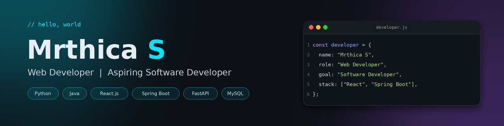
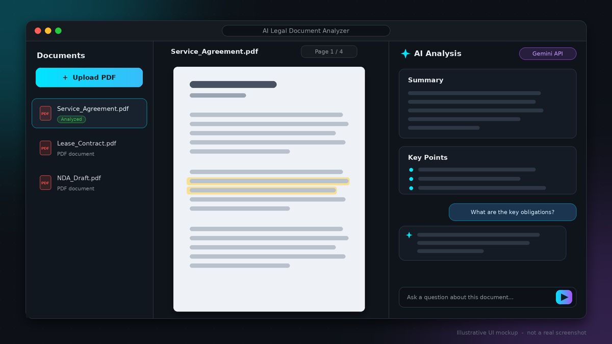
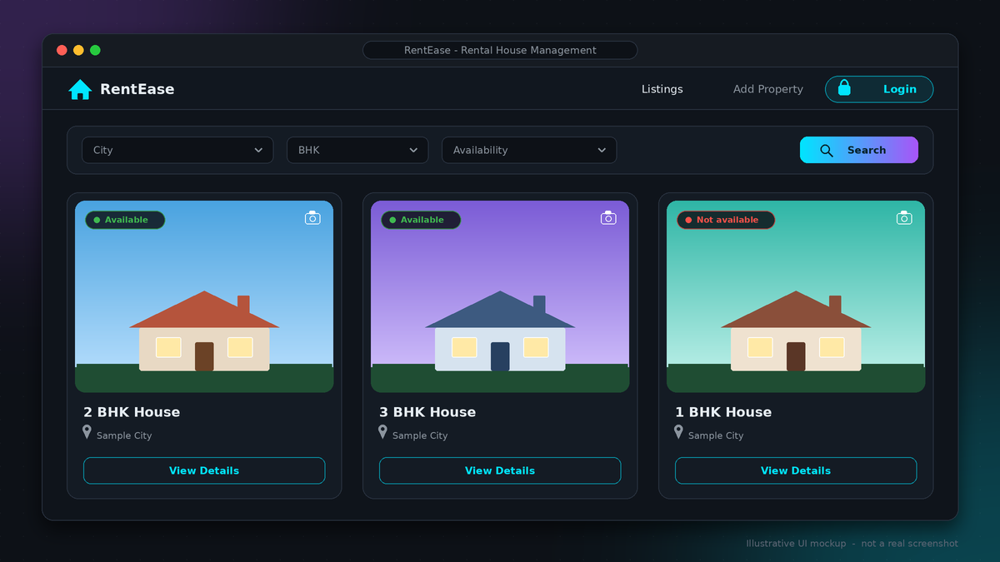
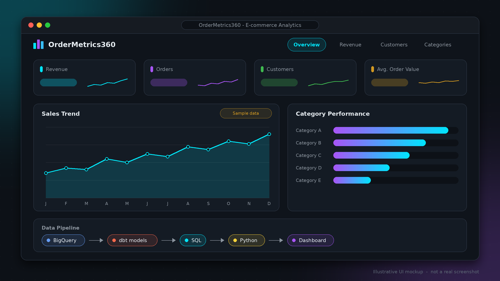
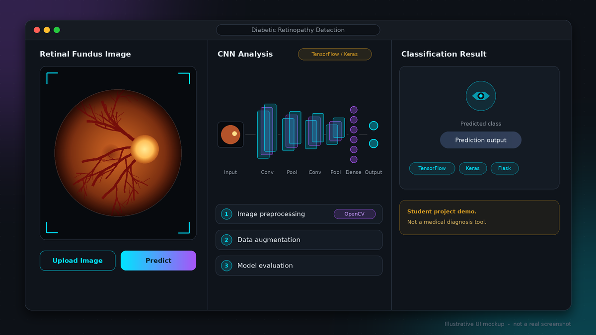

# Hi, I'm Mrthica S 👋

### Web Developer | Aspiring Software Developer

B.Tech Artificial Intelligence and Data Science student who enjoys building full-stack web applications 
with React, FastAPI and Spring Boot, and is looking to start a career in software development.

---

## 👩‍💻 Introduction

Welcome to my portfolio repository! I'm **Mrthica S**, a B.Tech student from Tiruchengode, Tamil Nadu, aiming for a career as a **Web Developer** and **Software Developer**.

This repository contains the source code of my personal portfolio website, where I showcase my projects, internships, skills and certifications.

🌐 **Live website:** [mrthica13.github.io/Mrthica-Portfolio](https://mrthica13.github.io/Mrthica-Portfolio/)

---

## 🙋‍♀️ About Me

- 🎓 B.Tech student in **Artificial Intelligence and Data Science** at Velalar College of Engineering and Technology (2023 – 2027)
- 💻 I enjoy building web applications: React.js front ends, Python and Java back ends, REST APIs and SQL databases
- 🔐 I have worked with JWT authentication and Swagger UI documentation in my backend projects
- 🤖 I have also explored AI and machine learning, including a CNN-based image classification project and the Google Gemini API
- 💼 I have completed two internships, in Machine Learning and Data Analysis
- 🎯 I am looking for entry-level **Web Developer / Software Developer** opportunities where I can learn, contribute and grow

---

## 🛠️ Tech Stack

| Category | Technologies |
| :-- | :-- |
| **💬 Programming** |    |
| **🌐 Web & Backend** |        |
| **🗄️ Databases** |    |
| **🤖 AI & Data** |         |
| **🧰 Tools** |      |

---

## 🚀 Featured Projects

> 🖼️ The preview images below are **illustrative UI mockups** created for this README. They are not screenshots of the running applications.

 

### 1️⃣ AI Legal Document Analyzer

An AI-powered full-stack web application for analyzing legal documents and generating intelligent document insights.

- 📄 Upload, analyze and summarize legal documents in PDF format
- 🔐 Secure authentication with JWT
- 🧠 AI-powered summarization using the Google Gemini API
- 🔌 REST APIs documented with Swagger UI, backed by a PostgreSQL database

 

### 2️⃣ RentEase — Rental House Management System

A rental house management application built with Java and Spring Boot.

- 🏠 Property listing and registration
- 🔎 City and BHK-based filtering with availability checking
- 🖼️ Image uploading for properties
- 🔐 Secure JWT-based authentication with Spring Security
- 🔌 REST APIs documented with Swagger UI

 

### 3️⃣ OrderMetrics360 — E-commerce Business Analytics

An analytics pipeline built on the Olist e-commerce dataset.

- ☁️ Nine tables loaded into Google BigQuery
- 🧱 dbt staging models with unique and not-null tests to ensure data quality
- 📊 SQL and Python used for analysis

 

### 4️⃣ Diabetic Retinopathy Detection

A deep learning project that detects diabetic retinopathy from retinal fundus images using a CNN.

- 🖼️ Image preprocessing and data augmentation
- 🧠 CNN model built with TensorFlow and Keras, with model evaluation
- 🌐 A simple Flask web application that shows the prediction results
- ⚠️ Built as a student project. It is not a medical diagnosis tool.

---

## 💼 Internship Experience

### Data Analyst Intern — Penta Software
📅 **June 2026**

- Worked with Excel, SQL, Python, Power BI and Tableau
- Data cleaning, data transformation and data visualization
- Exploratory data analysis (EDA), reports and dashboards
- Basic statistical analysis

### Machine Learning Intern — Neura AI Solutions Limited
📅 **December 2024**

- Hands-on experience in data analysis
- Machine learning model development

---

## 🎓 Education

| Degree | Institution | Duration | CGPA |
| :-- | :-- | :-- | :-- |
| **B.Tech — Artificial Intelligence and Data Science** | Velalar College of Engineering and Technology, Thindal, Erode | 2023 – 2027 | 7.1 / 10 |

---

## 🏅 Certifications & Activities

- 📘 **NPTEL** — Human-Computer Interaction (2025)
- 📗 **NPTEL** — Introduction to Industry 4.0 (2025)
- 📱 **Android App Development Workshop** — KSR Arts and Science College, Tiruchengode
- 🎖️ **National Cadet Corps (NCC)** — 1 year

---

## 🔗 Portfolio & Social Links

---

## 📬 Contact

| | |
| :-- | :-- |
| 📧 **Email** | [mrthica76@gmail.com](mailto:mrthica76@gmail.com) |
| 📍 **Location** | Tiruchengode, Tamil Nadu, India |
| 🌐 **Portfolio** | [mrthica13.github.io/Mrthica-Portfolio](https://mrthica13.github.io/Mrthica-Portfolio/) |
| 💼 **LinkedIn** | [linkedin.com/in/mrthica-s-a12602290](https://www.linkedin.com/in/mrthica-s-a12602290) |

---

### Thanks for visiting! 🙌

If you would like to work together, share feedback or just say hello, feel free to reach out.

**Always learning. Always building.** 🚀

